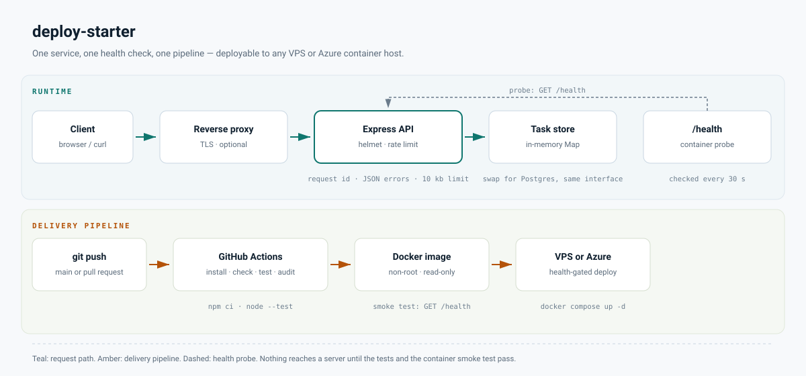

# deploy-starter

A small, production-minded Express API: Dockerized, tested, health-checked and deployed by CI. Small enough to read in one sitting, complete enough to show how I ship a service.




## What this repo demonstrates

- A **multi-stage Docker image** running as a non-root user, with a read-only filesystem and dropped Linux capabilities.
- A real **health check** consumed by Docker's `HEALTHCHECK` — no `curl` or shell inside the image.
- **Graceful shutdown** on `SIGTERM` / `SIGINT`, so a redeploy does not cut in-flight requests.
- **GitHub Actions** that installs, syntax-checks, tests, audits dependencies, builds the image and smoke-tests the running container.
- A consistent **JSON error contract**, request ids, security headers, rate limiting and a 10 kb body limit.
- **12-factor configuration** through environment variables only.

## Quick start

With Docker:

```bash
docker compose up --build
curl http://localhost:3000/health
```

With Node 20+:

```bash
npm ci
npm test
npm start
```

The API listens on `PORT` (default `3000`).

## API

| Method | Path | Description |
| --- | --- | --- |
| `GET` | `/health` | Liveness for the container probe. Returns `status`, `uptime`, `version`. |
| `GET` | `/api/tasks` | List tasks. |
| `POST` | `/api/tasks` | Create a task. Body: `{ "title": "..." }`. |
| `GET` | `/api/tasks/:id` | Read one task. |
| `PATCH` | `/api/tasks/:id` | Update `title` and/or `done`. |
| `DELETE` | `/api/tasks/:id` | Delete a task. |

Every response carries an `x-request-id` header, echoed in error payloads.

```bash
curl -s -X POST http://localhost:3000/api/tasks \
  -H 'content-type: application/json' \
  -d '{"title":"ship the pipeline"}'
```

## Design decisions

**The app and the server are separate.** `buildApp()` returns an Express app without listening; `server.js` owns the port and signals. Tests bind an ephemeral port and close their own connections, so they never collide with a running server.

**The store is an interface, not a database.** `createStore()` exposes `list`, `get`, `create`, `update`, `remove`. Swapping in Postgres means implementing those five methods, not editing routes. In-memory is a deliberate trade-off for a starter: zero infrastructure, zero persistence.

**No authentication.** This is not a multi-tenant service. Adding auth properly means sessions or tokens, rotation, and tests for both — not a middleware pasted in to look secure.

**`trust proxy` is explicit, and defaults to zero.** Set `TRUST_PROXY=1` only behind a single reverse proxy (Caddy, Nginx, Azure front door). Leaving it at `true` lets clients spoof their IP and bypass rate limits.

**Errors never leak stack traces.** The handler returns one JSON shape and logs the detail server-side with the request id.

## CI

Every push to `main` and every pull request runs:

1. `npm ci`
2. `npm run check` — syntax check on every source file
3. `npm test` — store and HTTP tests through the real app
4. `npm audit --omit=dev --audit-level=critical`
5. `docker build`
6. `docker run` + `curl /health` — the image must actually serve traffic

The container test is the point: a green build that cannot answer `/health` is not a deployable build.

## Deploying

On a VPS with Docker installed:

```bash
git clone <your-repo> && cd deploy-starter
docker compose up -d --build
docker compose ps        # api should show "healthy"
```

Environment variables:

| Name | Default | Purpose |
| --- | --- | --- |
| `PORT` | `3000` | Listening port. |
| `NODE_ENV` | `development` | Set to `production` in deployments. |
| `APP_VERSION` | `1.0.0` | Returned by `/health`; useful during rollouts. |
| `TRUST_PROXY` | `0` | Number of proxy hops in front of the API. Set to `1` behind Caddy/Nginx. |

Put a TLS-terminating proxy (Caddy or Nginx) in front of the container before exposing it publicly. This repo does not configure certificates.

## What this repo is not

- Not a SaaS, a boilerplate framework or a database-backed product.
- No persistence, no auth, no multi-tenancy.
- Not load-tested; the rate limit is a sane default, not a capacity plan.

## Possible next steps

- Postgres behind the same store interface, with migrations.
- OpenAPI spec generated from the routes.
- Prometheus metrics on `/metrics`.
- Publish the image to GHCR on tagged releases.

## License

MIT — see [LICENSE](LICENSE).
